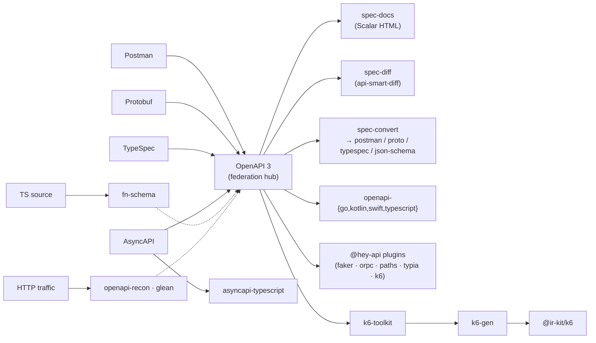

# ir-kit

[](https://pkg.pr.new)

A federation toolchain for API specifications — every standard talks to every other, and every downstream tool (SDK gen, docs, diff, load test, mock data) reads the same canonical input regardless of source format.

- **Spec interop** — OpenAPI 3, AsyncAPI 3, TypeSpec, Protobuf, Postman, JSON Schema. A graph-routed dispatcher chains converters automatically: register one edge into OpenAPI 3 and every other format unlocks combinatorially.
- **Standalone HTML docs** for any input — `ir docs api.proto --out docs.html` (renders via [Scalar](https://github.com/scalar/scalar)).
- **Cross-family diff** — `ir spec diff before.proto --after after.postman_collection.json` produces breaking / non-breaking classification via [`api-smart-diff`](https://github.com/udamir/api-smart-diff).
- **Native client SDKs** in Go, Kotlin, Swift, TypeScript — idiomatic per language, not transpiled from a TS base.
- **Spec-driven load testing** — typed [k6](https://k6.io) scripts with `defineLoadTest`/`flow().step()` chaining, no string-templating.
- **Spec discovery from traffic** — reverse-engineer an OpenAPI 3.1 spec from observed HTTP, either as a library or a Chrome extension.
- **Drop-in plugins for `@hey-api/openapi-ts`** — faker factories, oRPC clients, route maps, typia validators, and the k6 generator.

All native generators read one model, [`ir-kit/ir`](./packages/ir-kit/docs/ir.md), so 2.0 / 3.0 / 3.1 inputs land in the same shape. Per-target generators (`ir-kit/sdk/{go,kotlin,swift,java,typescript,k6}`) expose a pure `generate({ spec, output })` and don't require a hey-api plugin runner at the call site. Everything is reachable through the unified [`ir`](./packages/ir-kit/docs/cli.md) CLI or directly as a programmatic API per package.

## Pick a tool

| You want to… | Reach for | Surface |
| --- | --- | --- |
| Regenerate SDKs, docs and k6 clients from one config, and check them in CI | [`ir generate`](./packages/ir-kit/docs/generate.md) | `ir.config.ts` + `ir generate` / `ir generate --check` |
| Convert between any pair of spec formats (OpenAPI / AsyncAPI / TypeSpec / Protobuf / Postman / JSON Schema) | [`ir-kit/spec`](./packages/ir-kit/docs/spec-convert.md) | `convertSpec({ input, to })` or `ir spec convert` |
| Render any spec as standalone HTML docs | [`ir-kit/spec`](./packages/ir-kit/docs/spec-docs.md) | `renderDocs({ input })` or `ir docs` |
| Diff two specs (cross-family) with breaking-change classification | [`ir-kit/spec`](./packages/ir-kit/docs/spec-diff.md) | `diffSpecs({ before, after })` or `ir spec diff` |
| Load any spec uniformly (auto-detect OpenAPI / AsyncAPI / TypeSpec) | [`ir-kit/spec`](./packages/ir-kit/docs/spec-load.md) | `loadSpec({ input }) → { kind, document }` |
| Generate one Go / Kotlin / Swift / Java / TypeScript SDK, or AsyncAPI message models in those languages | `ir-kit/sdk/<lang>` | `generate({ spec, output })` or `ir sdk <lang>` |
| Load-test an OpenAPI API | [`ir-kit/k6-toolkit`](./packages/ir-kit/docs/k6-toolkit.md) on top of [`@ir-kit/k6`](./packages/k6/framework) | `sync()`, `runK6()`, `bundle()` |
| Reverse-engineer a spec from real traffic | [`@ir-kit/glean`](./apps/glean) (browser) or [`ir-kit/recon`](./packages/ir-kit/docs/recon.md) (lib) | DevTools extension / programmatic |
| Add faker mocks, oRPC clients, route maps, typia validators | hey-api [plugins](#hey-apiopenapi-ts-plugins) | `openapi-ts.config.ts` |
| Emit AsyncAPI 3.0 → TypeScript | [`ir-kit/sdk/asyncapi`](./packages/ir-kit/docs/sdk-asyncapi.md) | `generate({ spec, output })` |
| Extract JSON Schema from TS function signatures | [`ir-kit/fn-schema`](./packages/ir-kit/docs/fn-schema-core.md) | `runExtract()` or `ir fn-schema extract` |
| Do any of the above from one terminal entry point | [`ir-kit/cli`](./packages/ir-kit/docs/cli.md) | `ir <command>` |

## Use with AI coding agents

ir-kit ships one Agent Skill, [`skills/ir-kit`](./skills/ir-kit/SKILL.md), that teaches AI coding agents (Claude Code, Cursor, Copilot, Codex and others) how to drive `ir-kit`: the `ir.config.ts` workflow, every `ir` command, k6 loadtests, Hey API plugins, and migrating from the old `@ir-kit/*` packages.

```bash
npx skills add ahmedrowaihi/ir-kit        # this project
npx skills add ahmedrowaihi/ir-kit -g     # every project
```

The repo is also a Claude Code plugin: `.claude-plugin/` is committed at the root, so adding the repo as a marketplace surfaces the skill.

## How the pieces fit



`ir-kit/spec` graph-routes between every supported format — register a single `(X → openapi3)` and `(openapi3 → X)` edge and every other pair becomes reachable automatically. Internal building blocks (`codegen-core`, `openapi`, `openapi-tools`, `asyncapi-core`, `schema`) are listed under **Shared primitives** below — you usually consume one of the higher-level packages instead.

## Packages

### Toolkit

| Package | Description |
| --- | --- |
| [`ir-kit`](./packages/ir-kit) | API spec toolchain: load, convert, diff and document any API spec, and generate SDKs, mocks, validators and k6 load tests from it. |

### Load testing (k6)

| Package | Description |
| --- | --- |
| [`@ir-kit/k6`](./packages/k6/framework) | Framework for authoring k6 load tests in TypeScript: defineLoadTest, flow().step() chaining, pace presets, budgets, auth middleware. Compiles to standard k6. |

### Spec discovery from traffic

| Package | Description |
| --- | --- |
| [`@ir-kit/glean`](./apps/glean) | Glean — reverse-engineer OpenAPI 3.1 specs from traffic observed in your DevTools. |


Three `@hey-api/openapi-ts` plugins ship in lockstep via Changesets' `fixed` config (`openapi-ts-faker`, `openapi-ts-orpc`, `openapi-ts-typia`) — bumping one bumps all three. `openapi-ts-paths` and `openapi-ts-k6` version independently, as does everything else.

## Examples

| Example | Shows |
| --- | --- |
| [`petstore`](./examples/petstore) | One `ir.config.ts` turns `petstore.yaml` into Go, Kotlin, Swift, Java, TypeScript and k6 clients, and `user-events.yaml` into AsyncAPI building blocks. Each language has a consumer app under `<lang>/example/`; `k6/loadtest.ts` and `events/` run against the petstore demo and a local RabbitMQ. CI runs `ir generate --check` on it. |
| [`fn-schema-basic`](./examples/fn-schema-basic) | `ir fn-schema extract` (powered by `ir-kit/fn-schema`) extracts JSON Schemas for function inputs/outputs from TypeScript source; emit as files, bundle, or OpenAPI fragments. |

## Contributing

```bash
pnpm install
pnpm build
pnpm typecheck
pnpm test
```

Releases run on [Changesets](https://github.com/changesets/changesets):

```bash
pnpm changeset           # describe a change
pnpm version-packages    # bump versions + write CHANGELOGs (locally)
pnpm release             # build + publish via changeset publish
```

In CI, pushing a `.changeset/*.md` to `main` opens a "Version Packages" PR; merging that PR publishes to npm.

Every PR also triggers a [pkg.pr.new](https://pkg.pr.new) preview build — install any package at the PR's commit SHA without waiting for a release:

```bash
pnpm add https://pkg.pr.new/ir-kit/openapi-tools@<commit-sha>
```
